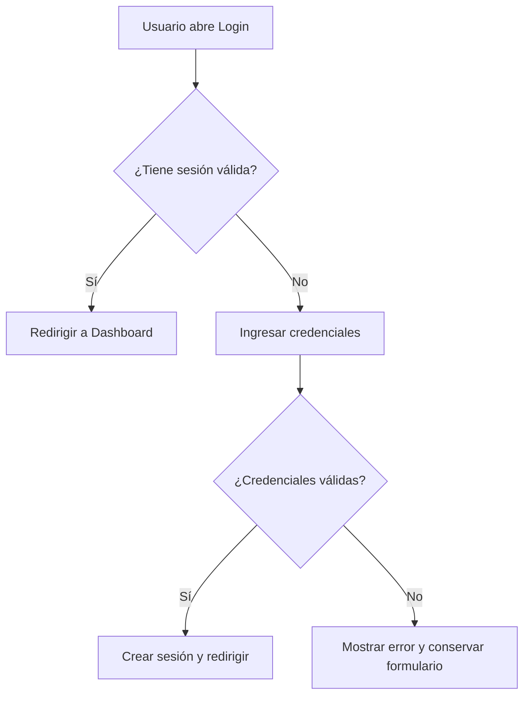
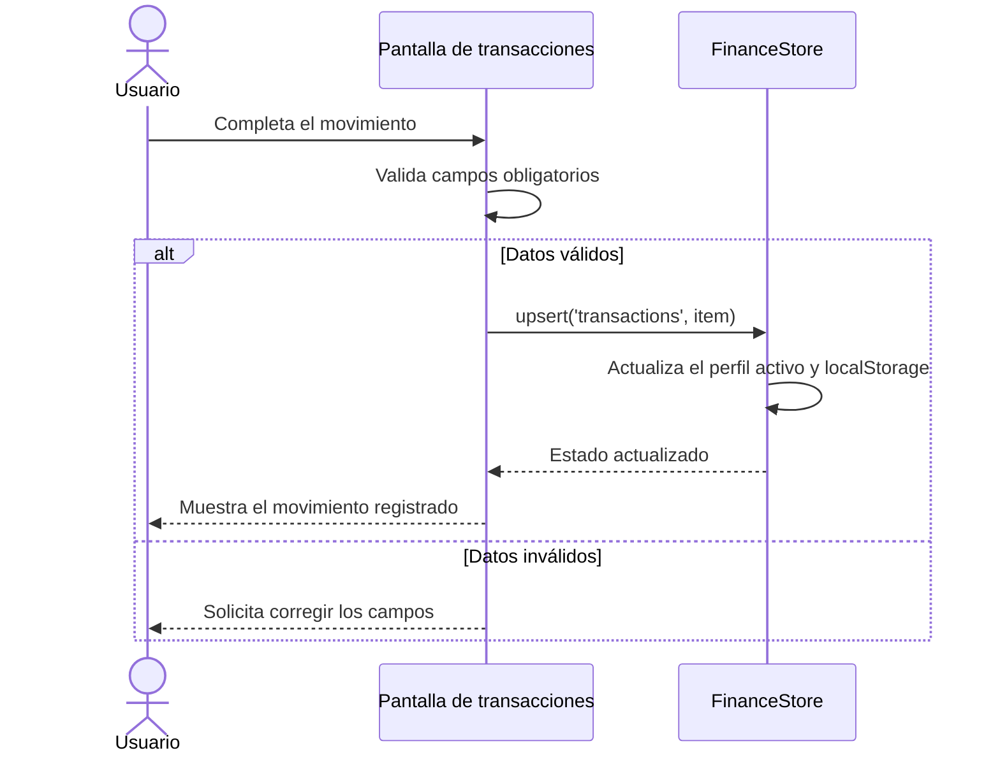
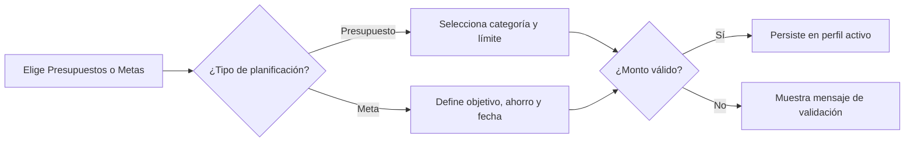
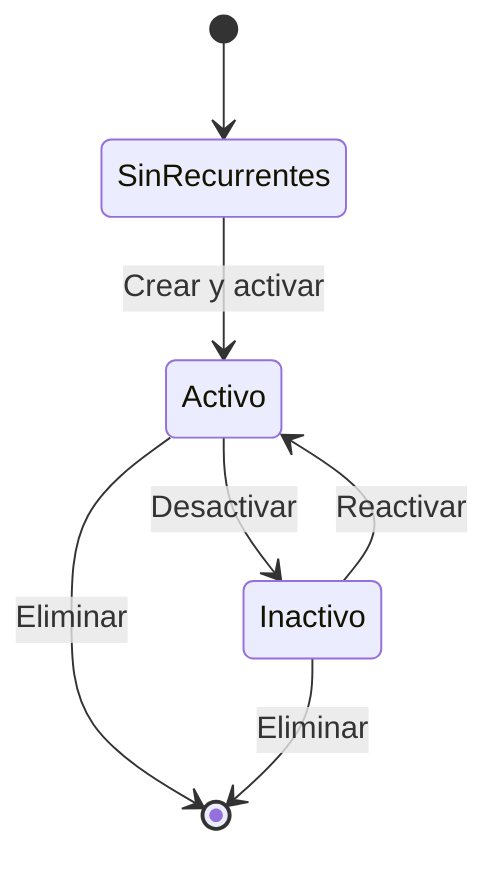
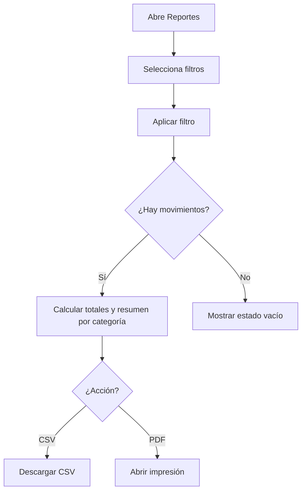
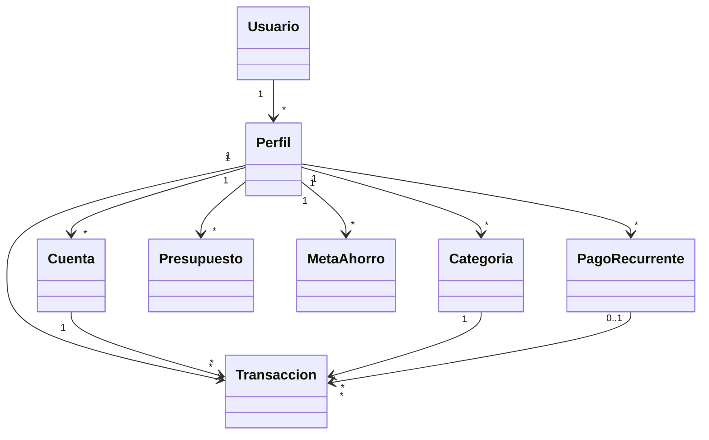
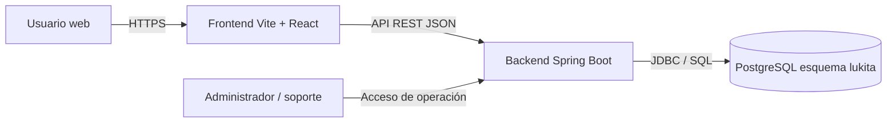

# Entregable: de la historia al diseño

## 1. Historia

Se seleccionaron 5 historias de usuario presentes o previstas por el prototipo Lukita. La propuesta cubre autenticación, administración financiera, planificación, recurrencias, reportes y preferencia entre perfil personal y empresarial.

| ID | Historia de usuario | Evidencia en el proyecto |
|---|---|---|
| HU-01 | Como usuario, quiero iniciar sesión para acceder a mi información financiera. | Rutas protegidas en `src/App.jsx`, almacenamiento de sesión en `src/lib/auth.js`. |
| HU-02 | Como usuario, quiero registrar y consultar transacciones para conocer mis movimientos. | Pantallas de transacciones y gastos extras en `src/page/finance/transactions.jsx`; datos en `src/lib/financeStore.jsx`. |
| HU-03 | Como usuario, quiero definir presupuestos y metas para controlar mis gastos y ahorros. | Módulo `src/page/finance/planning.jsx` y entidades presupuestos/metas en la base de datos. |
| HU-04 | Como usuario, quiero administrar pagos recurrentes para anticipar ingresos y egresos. | Pantalla `src/page/finance/recurring.jsx` y tabla `pagos_recurrentes` en `Lukita-BD.sql`. |
| HU-05 | Como usuario, quiero generar reportes por periodo, categoría y cuenta para evaluar mis finanzas. | Pantalla `src/page/finance/reports.jsx`, con resumen y exportación CSV/PDF. |

## 2. Actividades

### HU-01 — Inicio de sesión

**Decisiones / flujos**
1. **Camino exitoso:** el usuario registra o valida sus credenciales; el sistema crea una sesión y redirige a `/app`.
2. **Sesión existente:** si ya existe una sesión válida, el sistema impide volver a login y mantiene el acceso al dashboard.
3. **Error:** credenciales incorrectas o correo vacío muestran un mensaje; una sesión vencida se elimina y vuelve a exigir autenticación.

**Criterios de aceptación representados en el diagrama**

### HU-02 — Registro de transacciones

**Decisiones / flujos**
1. **Camino exitoso:** el usuario abre el formulario, selecciona tipo, cuenta y categoría, y guarda una transacción válida.
2. **Balance actualizado:** se recalcula el resumen y la transacción aparece en el listado y reportes del perfil activo.
3. **Error:** monto, descripción, cuenta o categoría inválidos impiden guardar y muestran un mensaje.

### HU-03 — Presupuestos y metas

**Decisiones / flujos**
1. **Camino exitoso:** el usuario crea un presupuesto por categoría o una meta con objetivo y fecha límite.
2. **Progreso de meta:** puede registrar un aporte; el monto actual avanza sin superar el objetivo de forma textual.
3. **Error:** límites, objetivos o montos negativos/impares no se guardan y se muestra una explicación.

### HU-04 — Pagos recurrentes

**Decisiones / flujos**
1. **Camino exitoso:** se crea o edita un pago con monto, frecuencia, cuenta, categoría y próxima fecha.
2. **Estado activo/inactivo:** el usuario puede activar, desactivar o eliminar el recurrente.
3. **Error:** sin monto positivo, cuenta o fecha válida, el formulario no se envía.

### HU-05 — Reportes

**Decisiones / flujos**
1. **Camino exitoso:** el usuario aplica fechas, categoría y cuenta; el sistema calcula ingresos, gastos y balance.
2. **Exportación:** puede generar CSV o activar la impresión para PDF con los datos filtrados.
3. **Error/sin datos:** un rango vacío muestra un estado sin movimientos, sin cálculos engañosos.

## 3. Componentes

### Páginas y módulos
- Inicio y autenticación: login, registro y rutas protegidas.
- Dashboard: saludo, perfil activo, resumen y navegación responsive.
- Mi dinero, transacciones y gastos extras: movimientos e ingresos.
- Categorías, presupuestos, metas y recurrentes: planificación financiera.
- Cuentas: administración de efectivo, banco y tarjeta.
- Reportes y configuración: filtros, exportaciones y preferencias.

### UI reutilizable
- `FinanceUI.jsx`: tarjetas, campos, botones, títulos y estados vacíos.
- `shared.jsx`: formularios y controles compartidos de movimientos y estadísticas.

### Datos y dependencias
- Frontend React 19 y React Router 7.
- Estado local mediante React Context y persistencia `localStorage`.
- Datos de prueba separados para perfiles personal y empresarial.
- Backend planificado con Spring Boot y PostgreSQL.
- Modelo relacional en `Lukita-BD.sql`, con usuarios, perfiles, cuentas, categorías, recurrentes, transacciones, presupuestos y metas.

### Relaciones principales

## 4. Despliegue

### Arquitectura objetivo

- **Nodos:** navegador del usuario, servidor de frontend, servidor Spring Boot y servidor PostgreSQL.
- **Artefactos:** código React compilado por Vite, archivo JAR de Spring Boot, script `Lukita-BD.sql` y archivos estáticos.
- **Protocolos:** HTTPS para cliente-servidor, HTTP/JSON para API REST y conexión JDBC/TLS hacia PostgreSQL.
- **Estado actual:** el prototipo funciona sin API; `localStorage` conserva datos y preferencias en el navegador.
- **Evolución futura:** sustituir `FinanceStore` por servicios REST, validar sesiones en servidor, aplicar migraciones y cifrado de contraseñas.

### Puntaje futuro de entregabilidad

1. **Funcional:** autentica usuarios y conserva operaciones en PostgreSQL.
2. **Usable:** mantiene navegación responsive y validaciones claras.
3. **Seguro:** elimina la firma local demo y usa tokens y autorización en backend.
4. **Probado:** incorpora pruebas unitarias, integración y end-to-end por historia.
5. **Operable:** usa variables de entorno, migraciones, monitoreo y respaldo de datos.

## 5. Conclusión

Lukita integra las historias principales de un gestor financiero personal y empresarial en un prototipo navegable. El diseño separa autenticación, navegación, componentes visuales y estado financiero reutilizable. Los cinco módulos seleccionados incluyen caminos exitosos, errores y criterios verificables. Los diagramas permiten validar relaciones entre usuarios, cuentas, categorías, movimientos, presupuestos y metas. El modelo SQL respalda las entidades y restricciones necesarias para una futura persistencia centralizada. El prototipo usa datos demostrativos y almacenamiento local, por lo que debe evolucionar hacia una API segura. Las siguientes prioridades son conectar Spring Boot, PostgreSQL y React mediante contratos REST probados.
